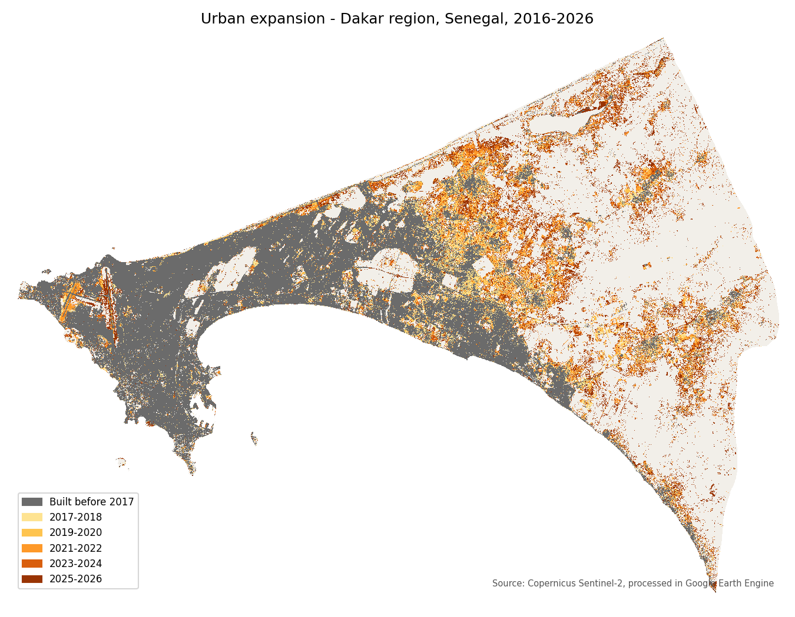

# SamaReew — urban expansion in Senegal

**SamaReew** (_sama réew_, "my country" in Wolof) is a public, open-data atlas that compares
Senegalese cities, inspired by [Our World in Data](https://ourworldindata.org). The first
theme is **urban expansion, 2016–2026**, in four cities: **Dakar, Touba, Thiès and Mbour**.

Built-up areas are mapped every year from **Sentinel-2** imagery with **Google Earth Engine**
and **one national Random Forest** model, then cleaned with a temporal consistency filter
and checked by an independent accuracy assessment.

The plan, the decisions taken and the decisions still open are in **[ROADMAP.md](ROADMAP.md)**:
read it first.

## Project status

| Milestone | Status |
|---|---|
| J0 — Setup (git, GitHub, licences) | Done |
| J1 — Study zones (zones, communes, centres, Touba sectors) | Done, frozen in [`zones/`](zones/README.md) |
| J2 — National model and classification | Done |
| J3 — Indicators and cross-check with GHSL / Open Buildings | Done |
| **J4 — National validation (480 photo-interpreted points)** | **In progress** on branch `j4-validation`: accuracy done, second reading of the cover in 2025 to do |
| J5 — Website v1 | To do |
| J6 — Publication | To do |

**Results so far** (2016 → 2025, details and limits in [METHODOLOGIE.md](METHODOLOGIE.md)):

| | Dakar | Touba | Thiès | Mbour |
|---|---|---|---|---|
| Built-up area 2016 → 2025 (ha) | 21,134 → 31,775 | 8,542 → 14,578 | 3,721 → 6,813 | 4,330 → 7,813 |
| Growth | +50 % | +71 % | +83 % | +80 % |
| Population (WorldPop) 2016 → 2025 | 3.50 → 4.20 M | 0.97 → 1.34 M | 0.44 → 0.55 M | 0.49 → 0.64 M |
| Built-up m² per inhabitant | 60 → 76 | 88 → 109 | 84 → 124 | 88 → 123 |
| SDG 11.3.1 (land / population growth) | 2.24 | 1.69 | 2.77 | 2.32 |
| Densification / extension / leapfrog (indicative) | 36 / 26 / 38 % | 37 / 35 / 27 % | 28 / 22 / 51 % | 37 / 27 / 36 % |
| New built-up confirmed by Open Buildings roofs | 48 % | 57 % | 43 % | 56 % |
| **Accuracy, built / not built 2025** (J4) | 0.87 ± 0.06 | 0.83 ± 0.07 | 0.86 ± 0.09 | 0.82 ± 0.09 |
| Accuracy, 3 classes 2016 → 2025 (J4) | 0.85 ± 0.07 | 0.78 ± 0.07 | 0.84 ± 0.09 | 0.77 ± 0.09 |
| Corrected built-up area 2016 → 2025 (ha, J4) | 17,019 ± 3,150 → 29,026 ± 5,470 | 6,998 ± 2,019 → 13,005 ± 2,871 | 5,668 ± 2,611 → 9,382 ± 3,225 | 3,461 ± 1,344 → 8,948 ± 2,562 |

- **Model** (J2): agreement with reference products 0.924 (kappa 0.849), 0.906 to 0.946 by city.
- **Indicators** (J3, step 4): by city, commune, Touba sector, direction and 2 km ring, in a
  long table with one fact sheet per indicator (`outputs/tables/`, format 0.1). WorldPop
  indicators are published for whole cities only; by commune, the 2023 census (RGPH-5) for
  the 60 communes entirely inside a zone.
- **Growth types** follow the Atlas of Urban Expansion rule. Their values move by up to
  20 points with the settings, but the ranking of cities is stable (Thiès always leaps most,
  Touba always extends most).
- **Cross-check** (step 6): 93–96 % of Open Buildings roofs fall in our built-up area; growth
  2016–2023 is close to Open Buildings in Dakar and Mbour, higher in Touba (artificial 2017
  jump) and Thiès (least reliable city). GHSL grows 2–4 times slower because its 2015 and
  2020 epochs are interpolated. WorldPop matches the census for city totals, not by commune.

- **Validation** (J4, step 5): 480 random points photo-interpreted blind, area-weighted
  estimates with 95 % margins (METHODOLOGIE §14.4). Over the four cities, 0.85 ± 0.04 of the
  area is correctly mapped as built / not built in 2025 (0.82 ± 0.04 with the three classes
  not built / built in 2016 / new). The total built-up area is right: 60,400 ± 7,400 ha
  corrected against 61,000 ha mapped in 2025, every city within its margin. The 2016
  built-up area is overestimated in Dakar, so its real growth is probably above +50 %.
- **Weak points confirmed by J4**: only half (0.51 ± 0.08) of the mapped new built-up area is
  real, but the map misses about as much elsewhere, so the corrected total (27,200 ± 6,800 ha)
  is close to the map (23,300 ha). Leapfrog is the least reliable growth type (45 % of its
  points are real new built-up, 5 out of 16 in Thiès; extension 69 %): growth types are
  indicative. The year of change is right within one year for 2 points out of 3; 2025 is
  provisional and 2017 is inflated in Touba (false detections, not only a low 2016 base).
  Touba is the least accurate city (sand and low buildings).

The tables keep the mapped values, consistent with the maps; the corrected areas are
published next to them, and each indicator fact sheet gives the measured accuracy.

**Next step** (J4, second reading decided on 07/10/2026): for the 228 points labelled not
built in 2025, note what covers the pixel on the 2025 image (closed list of METHODOLOGIE
§14.2: building on less than half, construction site, unbuilt subdivision, track, bare soil,
vegetation, water, other) in `outputs/validation/cover_2025.csv`, with
`outputs/validation/cover_2025.kml`, still blind. The report then adds a tolerant accuracy
where land being urbanised counts as built; the strict accuracy stays official. Then J5,
the website v1 (tools still to be chosen, ROADMAP §8).

## Study zones

The same rule for every city, so that cities can be compared (details in
[`zones/README.md`](zones/README.md)):

- **Zone** = GHSL urban cluster 2025 (GHS-SMOD, class ≥ 21) + **2 km** buffer, land only.
- **Public unit** = the **commune**, from OpenStreetMap (no open official dataset exists),
  corrected automatically. Touba is also split into **47 sectors** (central disc 0–2 km,
  then 2 km rings × 8 directions), because the commune of Touba Mosquée covers most of it.
  "Touba" means the Touba–Mbacké agglomeration; Mbacké's figures come from its commune.
- **Centre** of each city (for directions and distance rings): Place de l'Indépendance
  (Dakar), Grande Mosquée (Touba), Place de France (Thiès), fishing quay (Mbour).

| City | Urban cluster | Study zone | Communes |
|---|---|---|---|
| Dakar | 537 km² | 878 km² | 58 |
| Touba | 226 km² | 413 km² | 7 (+ 47 sectors) |
| Thiès | 140 km² | 375 km² | 8 |
| Mbour | 155 km² | 295 km² | 8 |

## Method

The full methodology note (theory, bands and indices, model, filter, evaluation, limits) is
in **[METHODOLOGIE.md](METHODOLOGIE.md)** (in French).

```
Sentinel-2 L1C (harmonised)            ESA WorldCover 2021 + Dynamic World 2021
        │ Cloud Score+ masking                    │ keep pixels where both agree
        ▼                                          ▼
Dry-season median composite        Training samples, balanced city × class
per city and year                  (1,500 points per class and per city), 70 % / 30 %
        │ + NDVI, NDBI, MNDWI, BSI                 │
        ▼                                          ▼
One national Random Forest (200 trees) ◄───────────┘   evaluated city by city
        │ classify 2016 … 2026, every city
        ▼
Yearly built-up maps ──► temporal consistency filter ──► year of urbanisation
                                                                 │
                                                                 ▼
             indicators by city, commune, sector, direction and ring (+ WorldPop population)
```

1. **Composites** — November–May (dry season, starting the previous year) median of cloud-masked Sentinel-2 scenes,
   one per city and year. Cloud Score+ removes clouds and shadows.
2. **Training data** — built / not-built labels taken only where two independent products
   (ESA WorldCover and Google Dynamic World) agree, to reduce label noise.
3. **Classification** — one Random Forest for the whole country, on 6 bands and 4 spectral
   indices (they help separate buildings from bright sand), so that cities are comparable.
4. **Temporal consistency** — a pixel is urbanised in year Y only if it is also built the
   next year, stays built in at least 80 % of the following years and at the end of the
   period (see `tests/test_postprocess.py`). The last year only confirms the previous ones:
   indicators cover 2016–2025.
5. **Indicators** — built-up area, base-100 growth, new built-up area, built-up share,
   growth type (densification / extension / leapfrog, Atlas of Urban Expansion rule);
   by city, population (WorldPop Global 2), built-up m² per inhabitant and SDG 11.3.1; by
   commune, the 2023 census population (RGPH-5) and built-up m² per counted inhabitant.
6. **Accuracy** — the 30 % test points only measure agreement with the reference products.
   True accuracy comes from a national sample (step 5): 120 points per city, stratified by
   map class with the new built-up area split by growth type, photo-interpreted blind in
   Google Earth Pro, then area-weighted accuracies and corrected areas with 95 % margins.

## Repository structure

```
config/
  settings.py        settings shared by all cities (years, season, model, thresholds, paths)
  cities.py          one entry per city: name, seed point, centre, sectors
  indicators.py      one fact sheet per indicator (public title, unit, definition, sources)
pipeline/            one step = one module, run from the project root
  s0_zones.py        study zones, communes, centres, sectors -> zones/ (frozen)
  s1_train.py        training samples + national Random Forest, agreement by city
  s2_classify.py     yearly built-up stacks per city
  s3_postprocess.py  urbanisation year, statistics, static map per city
  s4_indicators.py   indicators of every city -> long table + fact sheets in outputs/tables/
  s5_validation.py   validation sample (--draw), accuracy from the labels, second reading (--cover) -> outputs/validation/
  s6_crosscheck.py   comparison with Open Buildings Temporal and GHSL -> outputs/crosscheck/
src/                 reusable functions: gee_utils (Earth Engine), postprocess, zones, indicators,
                     crosscheck, validation
tests/               unit tests (pure functions, no Earth Engine needed)
zones/               frozen study zones (GeoJSON, versioned)
data/                ignored by git: downloads (data/raw/), training samples, stacks (data/cities/<city>/)
outputs/             model/ (evaluation), cities/<city>/ (results), tables/ (indicators for the site),
                     crosscheck/ (comparison with reference products),
                     legacy_dakar/ (first case study)
docs/                old Dakar web map (GitHub Pages), to be replaced by the site in J5
```

## How to run

```bash
# Python 3.12 with uv (https://docs.astral.sh/uv/); exact tested versions in requirements-lock.txt
uv venv .venv --python 3.12 && source .venv/bin/activate
uv pip install -r requirements-lock.txt
# or, without uv: python3.12 -m venv .venv && pip install -r requirements-lock.txt
# set GEE_PROJECT in config/settings.py (a Google Cloud project registered for Earth Engine)

python -m pipeline.s0_zones           # only to change the zones (they are frozen in zones/)
python -m pipeline.s1_train           # samples + national model -> outputs/model/
python -m pipeline.s2_classify        # all cities; --city touba for one; --drive to export via Drive
python -m pipeline.s3_postprocess     # all cities with a stack; --city touba for one
python -m pipeline.s4_indicators      # indicators of all cities -> outputs/tables/
python -m pipeline.s5_validation --draw  # validation sample, once -> outputs/validation/
python -m pipeline.s5_validation --cover # second reading sheet (points not built in 2025), once
python -m pipeline.s5_validation         # accuracy from the labels entered so far
python -m pipeline.s6_crosscheck      # comparison with Open Buildings and GHSL (--refresh to download again)
pytest
```

Practical notes:

- Step 0 caches its downloads in `data/raw/` (`--refresh` to download again). The public
  Overpass (OSM) servers are often busy: the step tries three mirrors in turn.
- Step 2 retrains the model from `data/training_samples.csv`, so it uses exactly the model
  evaluated in step 1. Run step 1 first.
- Step 4 downloads the WorldPop population of Senegal once (10 files of 17 MB) into
  `data/raw/worldpop/`.
- Step 6 downloads the reference maps once per city through Earth Engine (about 5 minutes for
  Touba, longer for Dakar) into `data/cities/<city>/`. It is numbered after step 5 (validation)
  in the plan, but only needs step 4.
- Step 5 draws the validation sample once (`--draw`; it refuses to overwrite labels already
  entered). Label `outputs/validation/labels.csv` without opening `sample_key.csv`, which holds
  the map class of each point; the accuracy can be computed at any time on the points labelled
  so far (`year_built` is entered as `YYYY` or `YYYY-MM`). The report
  (`outputs/validation/accuracy.json`) also gives the built / not-built accuracy and the
  corrected built-up area at each date, and the accuracy on sure labels only. After the
  labelling, `--cover` prepares a second reading of the points labelled not built in 2025
  (`cover_2025.csv`, `cover_2025.kml`); once it is complete, the report adds a `tolerant`
  section.
- `requirements.txt` lists the libraries; `requirements-lock.txt` pins the exact versions
  tested with Python 3.12 (the outputs in `outputs/` were checked identical with them). geemap
  uses a geedim function marked as deprecated: keep the pinned versions until it is updated.

## First case study: Dakar region (legacy)

Before the national project, the method was tested on the Dakar region (FAO GAUL boundary,
own model). Results are kept in `outputs/legacy_dakar/` for comparison with the national
model: built-up area 15,487 ha in 2016 → 26,266 ha in 2026 (+69.6 %), agreement with
reference products 91.8 % (kappa 0.84). Its validation sample (260 points) was abandoned
in favour of the national one.



## Limitations

- Sentinel-2 at 10 m detects groups of buildings rather than individual houses; small or
  scattered constructions can be missed.
- Bright sand, beaches and salt flats can be confused with built-up areas; the spectral
  indices and the temporal filter reduce but do not remove this.
- 2016 relies on Sentinel-2A only (fewer scenes). Dry years (2017, 2019) produce false
  detections at the urban fringe; the temporal filter removes most of them, but the
  2016→2017 jump is still inflated in Touba (+14 %; 4 of the 8 validation points dated 2017
  there are not built).
- The temporal filter has fewer following years to check near the end of the period. The
  last classified year (2026) is therefore not published: it only confirms 2025, and
  indicators cover 2016–2025. Growth in 2025 is still overestimated: 14 of the 27 validation
  points that the map dates to 2025 are not built.
- Sentinel-2A was launched in June 2015, so the series cannot start before the 2016 dry season.
- Population is modelled (WorldPop), not counted: it is spread over built-up areas seen
  from space. City totals match the 2023 census, but commune figures are off by a factor
  0.35 (dense working-class areas) to 2.9 (business, wealthy or resort areas), so WorldPop
  is published for whole cities only. The census covers only 2023 and only the communes
  entirely inside a zone (not Touba Mosquée).
- Leapfrog growth includes growth around villages and most of the remaining isolated
  false detections: 45 % of the leapfrog points are real new built-up in the validation
  (5 out of 16 in Thiès), so growth types are indicative.
- About half of the new built-up area has Open Buildings roofs within 30 m (75-84 % for the
  2016 built-up area); the validation confirms that half of the mapped new built-up area is
  wrong, although its total is about right.
- Almost half of the validation points (237 of 480) were marked unsure by the interpreter,
  and 21 points in Dakar and Thiès were labelled on 2023 imagery (no 2025 image).
- Commune boundaries come from OpenStreetMap and are not official (least reliable around Thiès).

## Tools

Python · Google Earth Engine · geemap · rasterio · GeoPandas · Shapely · NumPy · pandas ·
SciPy · scikit-learn · Matplotlib

## License

Code: [MIT](LICENSE). Produced data: [CC BY 4.0](LICENSE-DATA.md), except
`zones/communes.geojson` (derived from OpenStreetMap): ODbL 1.0.

## Author

**Moustapha Cisse** — Geomatics engineer, remote sensing and geospatial data engineering.
Contains modified Copernicus Sentinel data (2016–2026). Population: WorldPop Global 2
(R2025A, doi:10.5258/SOTON/WP00839), CC BY 4.0; census: ANSD, RGPH-5 2023, CC BY 4.0.
